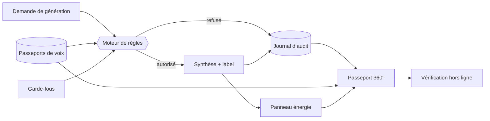

# Sawti 360 — Le doublage de confiance

Sawti 360 double un film de la derja vers le français, sous le contrôle du cinéaste. Chaque voix utilisée a un Passeport de voix signé par son titulaire, chaque décision est journalisée, et le film exporté part avec un Passeport 360° que n'importe qui peut vérifier.

« L’IA propose · L’humain décide · La confiance accompagne chaque export. »

Projet de l'équipe Houma Skhouna, présenté au hackathon IA Éthique 360, 5e édition, organisé par la Junior Entreprise INSAT (JEI, mandat 2026/2027) avec l'OIF. Premier dépôt : 15 novembre 2026.


Les captures viennent de la console du dépôt, lancée avec des données de démonstration. Aucune voix réelle n'y figure.

## Le problème

Formulation (à ajuster au gabarit officiel du cahier) : un cinéaste tunisien indépendant veut que son film tourné en derja soit vu par le public francophone. Le doublage en studio dépasse son budget. Les outils de doublage par IA existants ne lui disent pas à qui appartient la voix générée, ne lui laissent pas le dernier mot sur le texte, et lui demandent d'envoyer un film inédit sur un serveur qu'il ne contrôle pas.

> « Un film incompris reste invisible ; les sous-titres aident un peu ; le doublage fait voyager un film. »
> Mohamed Karim Dahmouni, cinéaste, entretien du 14 novembre 2026 (accord écrit d'image et de voix : à obtenir)

Nous sommes partis de cet entretien, puis nous avons vérifié ce qui existe avant de formuler le problème : observer, écouter, vérifier, formuler. Le journal des entretiens est dans [docs/ENTRETIENS.md](docs/ENTRETIENS.md). Un seul entretien est fait à ce jour, les autres sont marqués `[à recueillir]`.

## La solution

Le parcours de doublage a huit étapes : import local, séparation des pistes, transcription, validation par le cinéaste, traduction avec glossaire, vérification de fidélité, adaptation réplique par réplique, voix.

Autour de ce parcours, une couche de confiance fait cinq choses : elle vérifie la licence de chaque voix avant toute génération, elle garde le film sur la machine, elle étiquette ce que l'IA a produit, elle journalise chaque décision dans une chaîne de hachage, et elle mesure l'énergie consommée.

À l'export, le Passeport 360° rassemble tout cela dans un fichier signé.

| Ce que fait l'IA | Ce qu'elle ne décide pas |
|---|---|
| Elle propose une transcription | Le cinéaste valide le texte qui fait foi |
| Elle propose une traduction et signale les écarts de chiffres, de noms, de négations | L'adaptateur accepte, réécrit ou rejette chaque réplique |
| Elle génère une voix si le moteur de règles l'autorise | Le titulaire fixe les usages, les projets et la durée, et peut révoquer |
| Elle mesure sa consommation | Le référent éthique valide le passeport avant l'export |

## Lancer la démo

Il faut Python 3.11 ou plus récent. Tout tourne hors ligne, sur CPU.

```bash
git clone https://github.com/youssefbesbes/Sawti360.git
```

```bash
cd Sawti360 && python -m venv .venv && source .venv/bin/activate
```

```bash
pip install -r requirements.txt
```

```bash
python scripts/seed_demo.py
```

```bash
streamlit run app/streamlit_app.py
```

Le parcours à montrer en une minute :

1. Page « Demande de génération », voix `voice_inconnue` : refus, aucun audio n'est produit.
2. Même page, voix `voice_amine` : accord, avec le label visible et l'énergie mesurée.
3. Page « Passeport 360° » : générer, lire le QR, vérifier.
4. Page « Passeports de voix » : révoquer la licence d'Amine.
5. Retour à « Demande de génération » avec `voice_amine` : refus.

On peut aussi falsifier une entrée dans « Journal d’audit » et constater que la vérification échoue à cette entrée ([capture](docs/captures/08_falsification.png)).

Pour vérifier un passeport exporté sans ouvrir la console :

```bash
python scripts/verify_passport.py exports/passeport_360.json
```

Les tests :

```bash
pytest
```

Les diapositives du pitch sont sur Canva : https://canva.link/lu6nsgxbyjwdj6h (plan dans [docs/PITCH.md](docs/PITCH.md)).

## Architecture



Le code métier est dans `sawti/`, sans dépendance à l'interface. `app/` contient la console Streamlit, `scripts/` les trois commandes (données de démo, mesure du WER, vérification d'un passeport), `tests/` les 34 tests, `results/` les sorties mesurées. Les schémas détaillés, les flux de données et ce que nous avons écrit ou réutilisé sont dans [docs/ARCHITECTURE.md](docs/ARCHITECTURE.md).

## État d'avancement

| Module | État | Remarque |
|---|---|---|
| Passeport de voix (`licenses.py`) | fait | création, signature Ed25519, vérification, révocation |
| Moteur de règles (`rules.py`) | fait | fonction pure, 12 codes de décision, un test par code |
| Journal d'audit (`audit.py`) | fait | chaîne SHA-256, falsification localisée |
| Garde-fous (`guardrails.py`) | fait | voix inconnue, liste de blocage, signalement d'abus |
| Label, manifeste, générique (`label.py`) | fait | inspiré de C2PA, sans prétendre à la conformité |
| Passeport 360° (`passport.py`) | fait | JSON, HTML, QR, vérification en ligne de commande |
| Panneau énergie (`energy.py`) | fait | CodeCarbon |
| Coffre local (`vault.py`) | fait, minimal | chiffrement et rôles ; pas encore branché à l'import vidéo |
| Synthèse (`synth.py`) | porte faite, voix à venir | voir la note ci-dessous |
| Mesure du WER (`bench.py`, `run_wer.py`) | script prêt | il manque l'enregistrement |
| Vérificateur de fidélité (`fidelity.py`) | aperçu | règles sur les chiffres, les noms et les négations |
| Séparation des pistes, traduction, mixage, sous-titres | demi-finale | pas commencé |
| Shield, filigrane, intégrité des modèles, équipe rouge complète | finale | |
| Amazigh, mode festival, place de marché de voix | feuille de route | nous ne les construisons pas |

Note sur la synthèse : dans cette version, une génération autorisée produit un bip d'une seconde, pas une voix. Ce que nous montrons pour l'instant, c'est que rien n'est généré sans licence valide. La vraie synthèse arrive pour la demi-finale.

## Mesures

Un chiffre de ce dépôt est soit mesuré par le code, soit noté `[à mesurer]`.

| Mesure | Valeur | Comment |
|---|---|---|
| WER et CER en derja, Whisper `small` | `[à mesurer]` | `scripts/run_wer.py`, normalisation décrite dans `bench.normalize` |
| WER et CER en français | `[à mesurer]` | idem |
| Tests | 34 sur 34 | `pytest`, 15 novembre 2026 |
| Scénarios d'attaque automatisés | 18 sur 18 conformes | [results/attack_tests.md](results/attack_tests.md), régénéré à chaque exécution |
| Énergie de trois demandes de génération | 6,0 × 10⁻⁹ kWh, 3,4 × 10⁻⁶ gCO₂, 0,015 s | CodeCarbon hors ligne, [results/energy.json](results/energy.json) |
| Fidélité, précision et rappel sur 100 erreurs injectées | `[à mesurer]` | demi-finale |
| Détection d'erreurs avec et sans alertes | `[à mesurer]` | demi-finale |
| Test d'écoute | `[à mesurer]` | |
| Shield : taux d'erreur | `[à mesurer]` | finale |

La mesure d'énergie ne porte que sur la porte d'autorisation et le bip. Elle ne dit rien du coût d'une vraie synthèse vocale.

## Démarche éthique à 360°

Le détail est dans [docs/ETHIQUE.md](docs/ETHIQUE.md). En résumé, pour chacun des six angles du cahier :

**Les créateurs.** Le risque est qu'une voix soit clonée sans accord. Aucune voix n'est générée sans Passeport de voix, et le texte doit avoir été validé par un humain. Limite : la licence est aujourd'hui signée par la clé de la plateforme, pas par celle du titulaire.

**Les droits.** Le risque est l'usage hors contrat, ou la voix d'une personnalité. Le titulaire liste les usages interdits et peut révoquer ; une liste de blocage refuse les personnalités ; un bouton permet de signaler un abus. Limite : révoquer n'efface pas un audio déjà diffusé.

**Les données.** Le risque est la fuite d'un film inédit ou d'une empreinte vocale. Tout est traité en local, dans un coffre chiffré avec des rôles. Limite : la clé du coffre est un simple fichier.

**Cultures et langues.** Le risque est une IA qui comprend mal la derja. Nous publions un score par langue, même mauvais, et le cinéaste valide la transcription. Limite : notre jeu de test est petit et le score en derja n'est pas encore mesuré.

**Transparence.** Le risque est que le public ignore ce que l'IA a fait. Le film porte un label, un manifeste de provenance et un générique des voix. Limite : un label se retire d'une copie, et notre manifeste n'est pas certifié C2PA.

**La planète.** Le risque est d'utiliser de gros modèles sans compter. Chaque tâche est mesurée et le résultat figure dans le passeport. Limite : CodeCarbon donne une estimation.

Deux principes des fiches du mentor ne nous ont pas été transmis. Nous les avons traités comme « contrôle humain » et « équité » ; c'est une hypothèse.

Ce dépôt s'aligne sur les textes cités. Il n'a reçu aucune certification, et une relecture juridique est prévue. La détection de clone, quand elle existera, ne sera pas infaillible, et un filigrane audio peut être retiré.

## En cohérence avec la Francophonie

**Diversité culturelle et linguistique.** Le projet part de la derja, une langue que les outils de reconnaissance vocale traitent mal, et va vers le français. Nous mesurons la qualité langue par langue pour que l'écart soit visible. L'amazigh est sur la feuille de route.

**Jeunesse et entrepreneuriat.** Le Passeport de voix prévoit une rémunération par usage pour le comédien. Le montant et le modèle économique restent `[à définir]`.

**Inclusion et égalité.** L'outil vise les jeunes créateurs et les petites structures, qui n'ont pas accès à un studio de doublage. L'export prévoit des sous-titres français, utiles aux personnes sourdes ou malentendantes. Ils ne sont pas encore implémentés.

**Un numérique au service de l'humain.** Le consentement, les droits du titulaire et la liberté du cinéaste passent avant la génération : le moteur de règles refuse par défaut.

## Données et modèles

La liste des modèles et des jeux de données, avec leur licence, est dans [docs/DATASHEET.md](docs/DATASHEET.md). Cette version n'exécute aucun modèle d'IA dans le parcours de démo. Le dépôt ne contient aucun enregistrement d'une personne réelle.

## Équipe

| Rôle | Membre | Ce dont il ou elle s'occupe |
|---|---|---|
| Chef d'équipe, référent éthique | `[prénom]` | coordination, consentements, validation des passeports |
| IA parole | `[prénom]` | transcription, Sawti-Bench, synthèse, Shield |
| IA langue | `[prénom]` | traduction, glossaire, fidélité |
| Back-end et sécurité | `[prénom]` | règles, journal, passeport, coffre, équipe rouge |
| Front-end, audio, communication | `[prénom]` | console, mixage, vidéo, pitch |

## Feuille de route

- 15 novembre : premier dépôt, couche de confiance.
- 18 novembre : ateliers ; les retours iront dans `docs/RETOURS_WORKSHOPS.md`.
- 21 novembre : demi-finale, parcours complet sur un extrait d'une à deux minutes, avec l'accord écrit du cinéaste.
- 24 novembre : dépôt final, avec équipe rouge, Shield et filigrane.
- 25 novembre : finale, prototype utilisable hors ligne.

## Ce qu'il nous reste à fournir

- Un enregistrement de deux minutes en derja et sa transcription (`data/bench/derja_01.wav` et `.txt`), pour mesurer le WER.
- Les formulaires de consentement signés, dans `data/consents/`.
- L'accord écrit de Mohamed Karim Dahmouni, et la vérification des prix et sélections cités dans la vidéo.
- Les entretiens suivants.
- Les prénoms dans le tableau de l'équipe, et la vraie liste de blocage.

## Propriété intellectuelle

L'équipe garde la propriété intellectuelle du projet. L'OIF a un droit de premier regard, comme le prévoit le cahier des charges. Aucune voix n'est utilisée sans consentement écrit. La licence du code reste à choisir.
