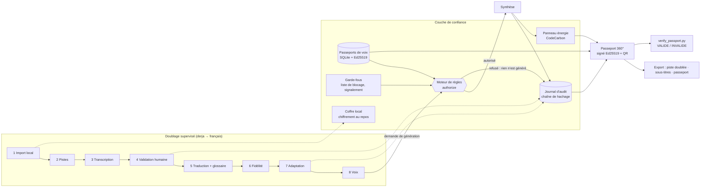
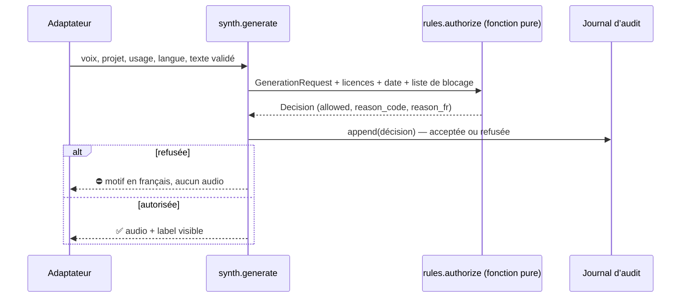

# Architecture — Sawti 360

## Vue d’ensemble

## Flux d’une demande de génération

Ordre des contrôles dans `authorize` : personnalité bloquée → voix enregistrée → signature → révocation → dates → usage interdit → usage autorisé → projet → langue → validation humaine. **Refus par défaut.**

## Flux de données

| Donnée | Où elle vit | Protection |
|---|---|---|
| Film ou vidéo inédits, pistes audio | `data/private/` (ignoré par git) | coffre local chiffré (Fernet), accès par rôle, aucun envoi réseau |
| Empreintes vocales (biométrie) | coffre local | chiffrées, supprimables à la révocation |
| Passeports de voix | `data/private/sawti.db` | signature Ed25519 de chaque licence |
| Journal d’audit | `data/private/audit.db` | chaîne de hachage SHA-256 |
| Clés | `keys/` (ignoré par git) | générées à l’exécution, jamais versionnées |
| Formulaires de consentement | `data/consents/` | seule l’empreinte SHA-256 entre dans la licence |

## Construit vs réutilisé

| Brique | Construit par l’équipe | Réutilisé |
|---|---|---|
| Passeport de voix, moteur de règles, journal d’audit, Passeport 360°, label, garde-fous | ✅ `sawti/` | `cryptography` (Ed25519, Fernet), `hashlib`, `sqlite3` |
| QR | intégration | `qrcode` |
| Énergie | enveloppe `energy.measure` | `codecarbon` |
| WER / CER | normalisation, script, Sawti-Bench | `jiwer`, `faster-whisper` |
| Console | pages et parcours | `streamlit` |
| Séparation, traduction, synthèse, Shield (à venir) | intégration, évaluation | Demucs, Opus-MT, Piper, SpeechBrain — licences dans `DATASHEET.md` |
